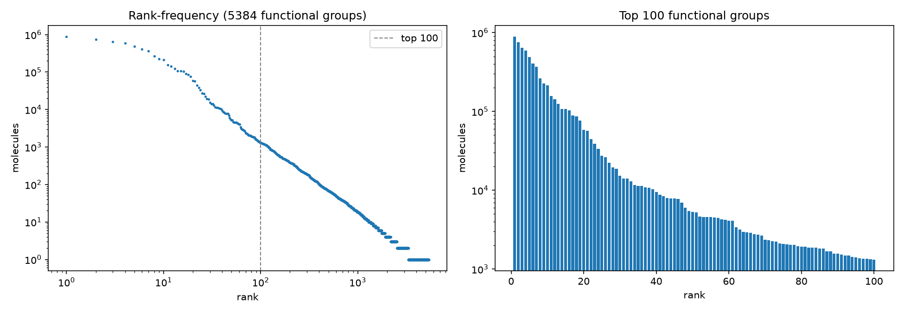
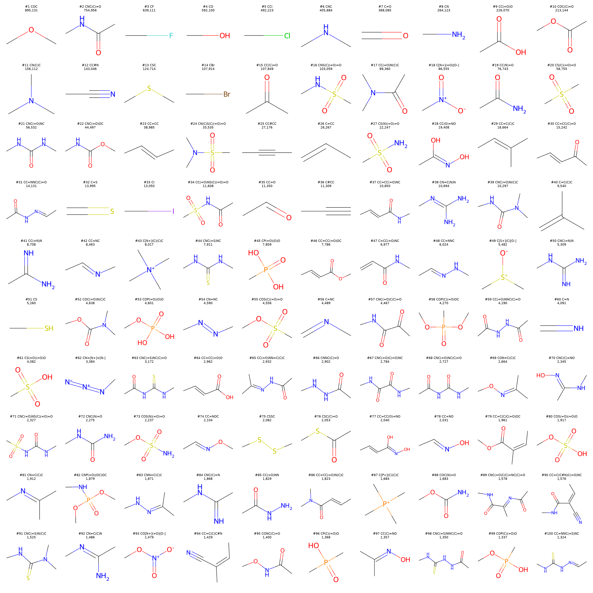
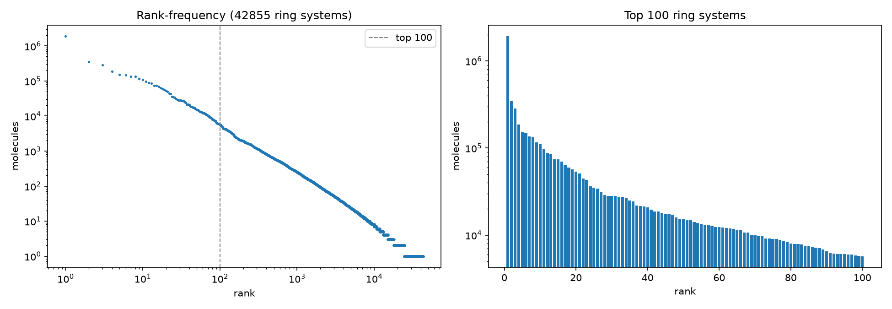
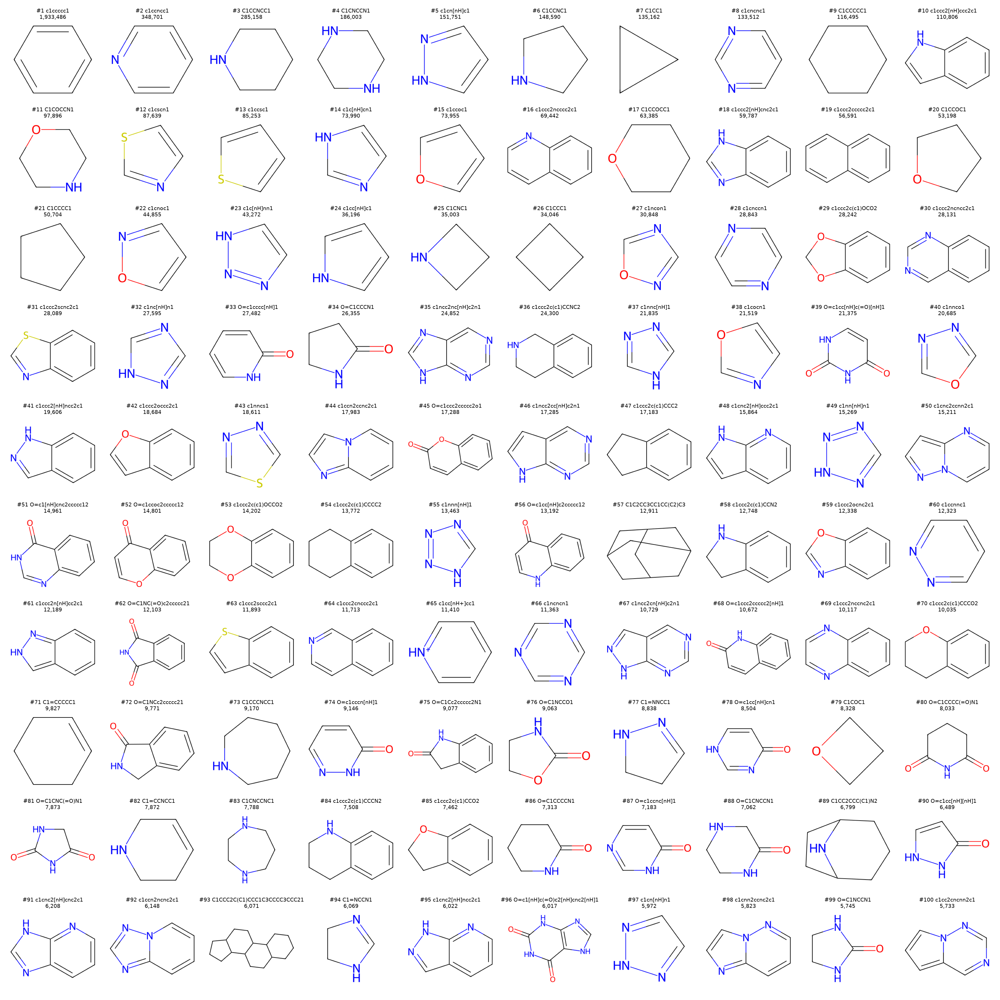
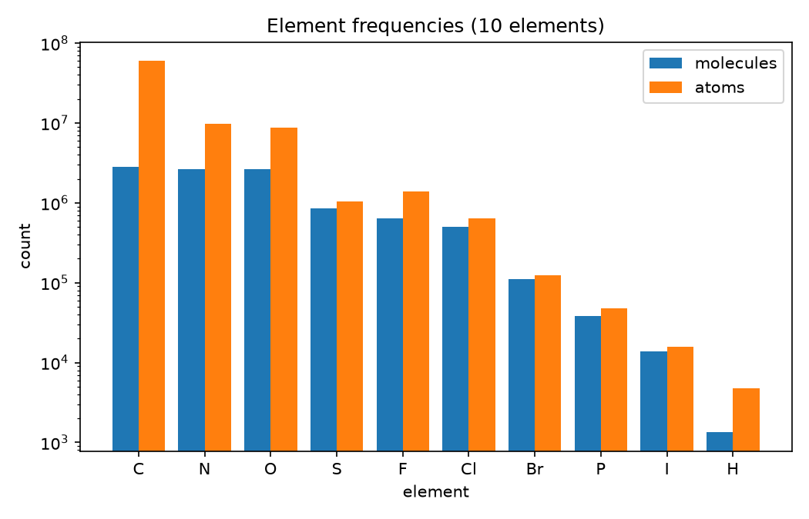

# moltally

Count how often **elements**, **functional groups** and **ring systems** occur in large SMILES
files (a chemical space) with RDKit.
The default input is filtered ChEMBL 37 (`src/moltally/data/chembl37.smi`, 2.8M molecules); each script runs in about
a minute on 24 cores. The scripts stream the input in bounded-memory chunks, so they also work on
billion-scale files.

```bash
uv sync
uv run enum-functional-groups   # Ertl functional groups
uv run enum-rings               # ring systems
uv run enum-elements            # element frequencies
# options: --input FILE --outdir DIR (default: results) --top N --workers N
# enum-functional-groups also: --include-ring-groups
```

## Outputs (one subdirectory per input in `results/`, e.g. `results/chembl/`)

| File | Content |
|---|---|
| `chembl37_functional_groups.tsv`, `chembl37_rings.tsv` | full counts: `smiles`, `molecules`, `occurrences` |
| `chembl37_elements.tsv` | per element: `molecules`, `pct_molecules`, `atoms`, `pct_atoms` |
| `chembl37_top100_fgs.smi`, `ring.smi` | the 100 most common groups / ring systems, one canonical SMILES per line |
| `chembl37_fg_frequency.png`, `chembl37_ring_frequency.png` | rank-frequency plots |
| `chembl37_top100_fgs.png`, `chembl37_top100_rings.png` | structure grids of the top 100 |

Rankings use `molecules`, the number of molecules containing the item at least once; ties are
broken by `occurrences` (total count over all molecules) and then alphabetically, so results are
reproducible.

## Method

**Functional groups** — `rdkit.Contrib.IFG.ifg.identify_functional_groups`, per molecule:
1. Groups with any atom in a ring are dropped.
2. The IFG `type` string is normalized: aromaticity, isotopes and stereo are removed and the
   SMILES is canonicalized, so `CO`/`cO` and `CC#N`/`cC#N` count as one group.

**Rings** — rings from `GetRingInfo().AtomRings()`; rings sharing two or more atoms (fused or
bridged) are merged into one **ring system** (benzimidazole is one system, not benzene + imidazole).
Substituents are replaced by hydrogens, atoms attached through exocyclic double bonds (C=O, C=S)
are kept, and the result is a canonical SMILES without isotopes or stereo.

## Results

5,384 distinct functional groups and 42,855 distinct ring systems were found (details are in the TSVs).

### Top 100 functional groups

Top 10 (full list: [`chembl37_top100_fgs.smi`](results/chembl/chembl37_top100_fgs.smi)):

| # | SMILES | molecules | occurrences |
|--:|---|--:|--:|
| 1 | `COC` | 895,131 | 1,278,150 |
| 2 | `CNC(C)=O` | 754,956 | 916,671 |
| 3 | `CF` | 639,111 | 1,395,050 |
| 4 | `CO` | 592,100 | 933,404 |
| 5 | `CCl` | 492,223 | 635,543 |
| 6 | `CNC` | 405,884 | 463,715 |
| 7 | `C=O` | 368,085 | 431,352 |
| 8 | `CN` | 264,123 | 296,394 |
| 9 | `CC(=O)O` | 226,070 | 247,782 |
| 10 | `COC(C)=O` | 213,144 | 261,112 |





### Top 100 ring systems

Top 10 (full list: [`ring.smi`](results/chembl/ring.smi)):

| # | SMILES | molecules | occurrences |
|--:|---|--:|--:|
| 1 | `c1ccccc1` | 1,933,486 | 2,860,560 |
| 2 | `c1ccncc1` | 348,701 | 378,136 |
| 3 | `C1CCNCC1` | 285,158 | 300,089 |
| 4 | `C1CNCCN1` | 186,003 | 189,412 |
| 5 | `c1cn[nH]c1` | 151,751 | 157,358 |
| 6 | `C1CCNC1` | 148,590 | 156,076 |
| 7 | `C1CC1` | 135,162 | 143,260 |
| 8 | `c1cncnc1` | 133,512 | 136,193 |
| 9 | `C1CCCCC1` | 116,495 | 120,268 |
| 10 | `c1ccc2[nH]ccc2c1` | 110,806 | 115,678 |





### Elements

Counted over all atoms of the parsed molecules (implicit hydrogens are not atoms). ChEMBL 37:

| element | molecules | % of molecules | % of atoms |
|---|--:|--:|--:|
| C | 2,813,430 | 100.00 | 73.70 |
| N | 2,647,107 | 94.09 | 11.75 |
| O | 2,629,020 | 93.44 | 10.58 |
| S | 857,065 | 30.46 | 1.25 |
| F | 642,387 | 22.83 | 1.71 |
| Cl | 495,559 | 17.61 | 0.78 |
| Br | 110,126 | 3.91 | 0.15 |
| P | 38,079 | 1.35 | 0.06 |
| I | 13,702 | 0.49 | 0.02 |
| H | 1,334 | 0.05 | 0.01 |

ZINC15 (872M molecules; results in `results/zinc/`):

| element | molecules | % of molecules | % of atoms |
|---|--:|--:|--:|
| C | 872,216,656 | 100.00 | 72.37 |
| N | 867,878,273 | 99.50 | 13.56 |
| O | 856,537,473 | 98.20 | 10.71 |
| S | 226,968,981 | 26.02 | 1.15 |
| F | 188,337,633 | 21.59 | 1.56 |
| Cl | 90,524,765 | 10.38 | 0.47 |
| Br | 35,125,958 | 4.03 | 0.16 |
| I | 1,896,206 | 0.22 | 0.01 |
| P | 95,519 | 0.01 | 0.00 |
| B | 38,560 | 0.00 | 0.00 |



## Limitations

- **Normalization loses information.** Aromatic and aliphatic neighbours are merged, so an alcohol
  and a phenol are both `CO`, and an aryl and an alkyl ether are both `COC`. Isotopes and stereo
  are discarded. Differences in substituents are *not* merged (`CC(=O)N(C)C` vs `CNC(=O)N(C)C`),
  which leaves a long tail of near-duplicates.
- **Ring-embedded groups are excluded.** A group is dropped if any of its atoms is in a ring. This
  removes lactams, ring amines, aromatic heteroatoms and similar groups; they only show up
  indirectly as ring systems. Only the group's own atoms are checked, not its neighbours.
- **Ring-system definition is a choice.** Spiro and biaryl-linked rings are counted separately.
  Rings are also stripped of substituents, so a ring system's substitution is not counted;
  exocyclic C=O/C=S are kept, so cyclohexane and cyclohexanone are different entries.
- **Some ring systems are skipped.** The stripped fragment must re-sanitize in RDKit; 1,242
  ring-system instances (odd fused aromatic systems such as azulene-like ones) fail and are left out.
  Hydrogens on stripped atoms are assigned by a simple rule, which may be wrong for unusual
  charged or hypervalent atoms.
- **Dataset bias.** Counts reflect ChEMBL, a medicinal chemistry collection, not chemical space in
  general. The input is not standardized (salts, tautomers and charge states are used as given, no
  largest-fragment selection), and SMILES that RDKit cannot parse are silently skipped.
- **Frequency is not importance.** Counts are weighted by how many analogues ChEMBL contains
  per series, so common scaffolds from large series are over-represented. The ring top 100 favours
  small rings, since larger systems are fragmented across a very long tail of rare entries.
- **Elements.** Hydrogen appears only where SMILES contain explicit `[H]` atoms.
- **Housekeeping.** The ChEMBL file is stored in the package data folder, and the project
  directory is still called `enum-funcs`.
